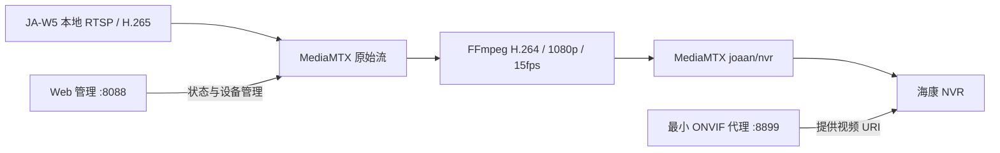

# 乔安 JA-W5 本地取流与录像机接入记录

将一台原本主要通过「乔安智联」使用的 **乔安 JA-W5 5MP、5V/1A 常供电 Wi-Fi 摄像头**接入海康录像机的实机记录，以及可运行的 RTSP 中转、H.264 转码、最小 ONVIF 代理与 Web 管理示例。

**结论：这台样机存在本地 RTSP，无需先完整逆向厂商云端协议。** App 没有 RTSP / ONVIF 开关，不等于固件没有本地服务。本文只代表这一台样机，不能保证所有同型号、硬件批次或固件一致。摄像头固件版本未可靠获取；分析的 Android App 版本为 **5.3.22.40**。

## 最终工作链路



实测录像机：**海康 DS-7932HQH-K4，V3.5.40**。已验证通道在线以及从录像机取得实际画面；这与“录像已持续写入硬盘”是不同的验收项。

## 已验证的发现

| 项目 | 本次样机结果 |
|---|---|
| 本地 RTSP | TCP 554 可达，OPTIONS 正常，DESCRIBE 可能要求认证 |
| 主码流路径 | `/live/ch0_0` |
| 子码流路径 | `/live/ch0_1` |
| 原始主码流 | 实测 H.265、2304×1296、约 15 fps，带 G.711 |
| 原始子码流 | 实测 H.265、640×360 |
| 网页管理 | 存在本地管理页面 `/apcam/index.asp` |
| 摄像头 ONVIF | 本次发现 TCP 8899，可读取网络参数；不代表完整兼容认证 |
| 静态 IP | 使用 ONVIF `SetNetworkInterfaces` 关闭 DHCP 并写入地址；实际重启后确认生效 |
| NVR 兼容 | 原始流报“IP 通道码流不支持”；转 H.264 后经最小 ONVIF 代理成功出图 |

APK 静态分析发现 `setLocalRtspAuthKey`、`RtspConf` 等配置线索，以及 TUTK 和乔安 RTC 两套取流实现。**代码中出现某项能力，不代表当前设备固件一定实现。** 仓库不分发 APK、反编译厂商代码或 SDK。

## 快速运行

依赖：Python 3.10+、FFmpeg（含 libx264）、[MediaMTX](https://github.com/bluenviron/mediamtx)。本次部署使用 MediaMTX 1.21.2。下面是原型部署步骤，不是适用于所有设备的一键安装脚本。

1. 将示例配置复制为本地 `mediamtx.yml`，按实际网络填写摄像头 IP、账号密码及允许访问的网段。账号密码中的特殊字符必须 URL 编码。
2. 启动 MediaMTX：`mediamtx mediamtx.yml`。API **只监听 loopback**。
3. 用本地 FFmpeg 验证原始流真的有帧，而非只验证 RTSP 握手：

   ```sh
   ffmpeg -rtsp_transport tcp -i rtsp://127.0.0.1:8554/joaan/main -frames:v 1 -f null -
   ```

4. 启动转码，详见 [部署说明](docs/deployment.md)。输出为 `rtsp://SERVER_IP:8554/joaan/nvr`。
5. 启动只读 ONVIF 代理，手动向 NVR 添加 `SERVER_IP:8899`；默认配置只允许本机访问，需明确设置本地允许网段与监听地址。
6. 初始化 Web 管理账号，然后启动管理服务：

   ```sh
   python3 tools/init_admin.py --data-dir ./local-state
   DATA_DIR=./local-state PUBLIC_HOST=192.168.10.10 WEB_BIND=127.0.0.1 python3 src/dashboard.py
   ```

   默认访问 `http://127.0.0.1:8088/`，用户名 `admin`，密码由你初始化。需要局域网访问时，将 `WEB_BIND` 设置为服务器 LAN 地址。`PUBLIC_HOST` 为录像机和客户端可访问的服务器地址。

**仓库内所有网络地址是示例，不是作者的实际网络。** 前端设备信息和拓扑中的摄像头、光猫、路由器、录像机示意地址需要自行修改，不能当作自动探测结果。

## Web 管理能力与边界

左侧栏提供总览、摄像头管理、拓扑、录像机接入、系统状态。支持新增/修改/移除通用 RTSP 摄像头、配置持久化、状态/码率/连接数查看和中转地址复制。

- 示例中的现有 `joaan` 设备受保护，避免误改专用链路。
- 新设备经 MediaMTX 原样转发，**不会自动转 H.264，也不会自动创建各自的 ONVIF 设备**。
- 摄像头源地址中的密码保存在本机 `cameras.json`，权限为 0600；管理密码存 PBKDF2 哈希。列表接口不返回源地址密码。
- 配置启动时自动协调到 MediaMTX；这是小型 LAN 原型，尚无多用户权限、审计日志、TLS、分布式锁或成熟的事务回滚。请勿直接暴露公网。
- 只读 ONVIF 代理没有 WS-Security 用户验证，依靠来源网段限制；NVR 中填的用户名不构成代理认证。它不是 ONVIF 认证产品，也不提供 PTZ、音频、事件或录像回放。
- 当前图形拓扑针对这条样机链路；其他摄像头在列表和连接关系中显示，尚未实现自动网络发现与图布局。

## 最容易踩的坑

1. **App 能看，不代表 RTSP 出帧。** 登录、OPTIONS、DESCRIBE、PLAY 成功也不等于收到 RTP 数据。要实际解码帧。
2. **App 依赖云服务，不代表视频必经云转发。** 优先验证局域网服务，少走完整云协议逆向的弯路。
3. **认证方式可能变化。** 本次 Wi-Fi 重新配网后观察到 Digest；只实现 Basic 的探测脚本会误判。FFmpeg/MediaMTX 可协商；不要把不同认证失败当作端口或路径错误。
4. **编码设置接口可能“成功但无效”。** 本次 ONVIF 编码修改未带来实际 H.264 输出，因此采用服务器转码。需同时读回参数并检查真实码流。
5. **静态 IP 不一定立即生效。** 本次实际重启后地址才变更，中转仍指旧 IP，导致录像机离线；更新源地址后恢复。
6. **DHCP 绑定与设备静态 IP 不同。** 本次改的是摄像头网络接口，不是光猫的绑定功能。必须在 DHCP 池外预留地址，每台唯一。
7. **多级路由不要混淆方向。** NVR 经下级路由器主动访问上级网段服务器，和上级服务器访问下级摄像头不是同一种连通性。优先将摄像头和服务器放同一可达 LAN，避免无必要的映射。
8. **排除代理干扰。** Python `urllib` 可能读取系统 HTTP 代理，LAN 探测应使用 `ProxyHandler({})`。
9. **NVR 显示在线不是最终验收。** 获取 NVR 实际画面、重启恢复、断线恢复及录像回放应分别验证。

参见 [网络与静态地址](docs/network.md)、[研究证据与复现边界](docs/research.md)、[部署说明](docs/deployment.md)。

## 贡献

欢迎提供**脱敏**的硬件批次、固件版本、RTSP SDP、编码信息、NVR 型号与复现步骤。不要提交账号密码、设备 UID、MAC、序列号、原始抓包、APK 或现场视频。对不同批次的结论请明确标注“已验证 / 推测 / 未实现”。

项目代码采用 MIT 许可。第三方 MediaMTX、FFmpeg 和厂商软件不在本仓库分发，各自遵循其许可。
